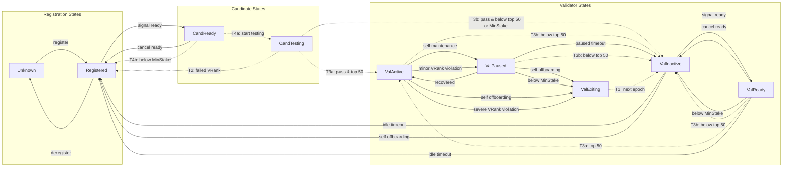

## Abstract

This KIP introduces an automatic state transition framework for candidates and validators in the permissionless Kaia network. It defines 9 states (2 registration states, 2 candidate states, 5 validator states) and their allowed transitions, enabling decentralized validator lifecycle management without manual intervention from the Kaia team.

## Motivation

The current Kaia network operates in a permissioned manner where the Kaia team manually manages validator states. As the network transitions to permissionless operation, an automatic state management system becomes necessary.

With KIP-227 introducing VRank for quantitative evaluation of validators, this KIP establishes the state machine that governs:

- How candidates join the network through a VRank testing
- How validators participate in consensus based on stake ranking
- How validators are paused or removed upon VRank violations
- How validators can voluntarily exit or perform maintenance

This framework enables trustless validator lifecycle management while maintaining network stability through structured state transitions.

## Specification

### Parameters

The following parameters are used in this KIP:

| Parameter                | Description                                                                                                                                        | Sample Value                                                  |
| ------------------------ | -------------------------------------------------------------------------------------------------------------------------------------------------- | ------------------------------------------------------------- |
| `MaxNodeCount`            | Maximum number of nodes in non-Registered states (CandReady, CandTesting, ValActive, ValReady, ValInactive, ValPaused, ValExiting)                | 100                                                           |
| `MaxValActivePausedCount` | Maximum allowed number of nodes in `ValActive` or `ValPaused` (used as the epoch slot competition limit)                                          | 50                                                            |
| `MaxCandReadyCount`       | Maximum number of candidates that can be in `CandReady`                                                                                           | 3                                                             |
| `MinStake`               | Minimum staking amount required to enter the consensus                                                                                             | 5,000,000 KAIA                                                |
| `ValPausedTimeout`       | Added to the time of entry into `ValPaused` to set the pause deadline (see [Timeout Transition](#timeout-transition)) | 8 hours                                                       |
| `ValIdleTimeout`         | Added to the time of the first entry into `ValInactive` or `ValReady` since the idle timer last reset to set the idle deadline (see [Timeout Transition](#timeout-transition)) | 30 days                                                       |
| `MinActiveCount`         | Minimum number of `ValActive` validators required for BFT liveness                                                                                 | `n` if `n < 4`, else `ceil(2n/3)` where `n` = [`epochVACount`](#transition-ordering) |
| `ValPausedSlotLimit`     | Maximum number of validators that can be in `ValPaused`                                                                                            | `0` if `n < 4`, else `ceil(floor(n/3) / 2)` where `n` = [`epochVACount`](#transition-ordering) |
| `ValExitingSlotLimit`    | Maximum number of validators that can be in `ValExiting`                                                                                           | `0` if `n < 4`, else `ceil(floor(n/3) / 2)` where `n` = [`epochVACount`](#transition-ordering) |
| `VRankEpoch (Epoch)`     | Epoch interval for vrank                                                                                                                           | 86400                                                         |
| `PFS_THRESHOLD`          | Threshold for proposal failure score (PFS) per epoch. PFS ≥ PFS_THRESHOLD indicates severe violation (defined in [KIP-227](./kip-227.md))          | 2                                                             |
| `CFS_THRESHOLD`          | Threshold for candidate failure score during VRank testing. CFS ≥ CFS_THRESHOLD indicates failing the testing (defined in [KIP-227](./kip-227.md)) | 300                                                           |

> **Note**: The permissionless hardfork block number MUST be a multiple of `VRankEpoch`. Otherwise the first post-fork epoch cannot accumulate scores over a full `VRankEpoch` window, and any query into the pre-fork portion of that epoch has no VRank data to return.

> **Note**: `MinStake` has two sources, which MUST be equal. The AddressBookV2 constant `MIN_STAKE` ([KIP-290](./kip-290.md)) gates the user transitions `readyCandidate` and `readyValidator`. The governance parameter `reward.minimumstake`, fixed in the genesis configuration and not votable, gates the system transitions and reward eligibility. Both are 5,000,000 KAIA on Kairos and mainnet.

### Overview

The framework defines 9 states divided into three categories:

- **Registration States**: Unknown, Registered
- **Candidate States**: CandReady, CandTesting
- **Validator States**: ValActive, ValReady, ValInactive, ValPaused, ValExiting

State transitions may occur either **at epoch interval** or **at arbitrary blocks**. Any event that occurred at block `N` **must take effect starting from block `N+1`**. For example, if a validator in `ValActive` state requests a transition to `ValPaused` at block `N`, the validator remains in `ValActive` for block `N`, and transitions to `ValPaused` starting from block `N+1`.

Only validators in **ValActive** state participate in consensus and receive rewards. The active validator set consists of the top 50 validators by staking amount at the epoch interval block.

**Staking Amount**: A node's staking amount (`stake` in the pseudocode) is `staking() - unstaking()` of its single CnStakingV4 contract registered in AddressBookV2 ([KIP-290](./kip-290.md)), floored to whole KAIA. The system transitions of block `N` read it from the state after block `N-1`, and a user transaction reads it from the state in which it executes. This amount decides the top-50 ranking, with the address tie-break of the [Epoch Transition](#epoch-transition), and every `MinStake` check. Stake in Consensus Liquidity pools ([KIP-226](./kip-226.md)) is not counted for the ranking or for `MinStake` eligibility.

**Idle Timer**: Validators in `ValInactive` or `ValReady` states are subject to `ValIdleTimeout`. The idle timer accumulates across both states and **only resets when the validator transitions to `Registered` or `ValActive`**. Transitions between `ValInactive` and `ValReady` do not reset the timer. This mechanism prevents a validator from remaining indefinitely in the ValInactive/ValReady states.

### Registration States

| State      | Description                                                          |
| ---------- | -------------------------------------------------------------------- |
| Unknown    | Conceptual state representing entities not registered in the system. |
| Registered | State representing entities that are registered in the system.       |

### Candidate States

| CandReady | Candidate has signaled readiness to participate in VRank testing at the next epoch. |
| CandTesting | Candidate undergoing VRank testing to prove infrastructure reliability. |

### Validator States

| State       | Description                                                                                                         |
| ----------- | ------------------------------------------------------------------------------------------------------------------- |
| ValActive   | Active validator that has earned a top-50 position. Participates in consensus unless suspended. Must be in top 50 by staking amount. |
| ValReady    | Validator has signaled readiness to become `ValActive`. Waiting for top 50 position.                                |
| ValInactive | Inactive validator not participating in consensus. Need to signal readiness or exit to avoid timeout.               |
| ValPaused   | Validator in maintenance/recovery mode. May be voluntary or forced by VRank violation.                              |
| ValExiting  | Transitional state for current epoch. Becomes `ValInactive` at next epoch.                                          |

### Qualified Validators

The **qualified validator set** (also referred to as the **committee**) is the set of validators that participate in consensus and are eligible to produce and verify blocks at a given block number:

```
qualified(N) = {ValActive at N} - {Suspended at N}
```

If the entire `ValActive` set is suspended (safety fallback), `qualified(N)` falls back to all `ValActive` validators.

**Suspension**: an overlay on `ValActive`, not a state. The suspended set is maintained by the suspender role of AddressBookV2 ([KIP-290](./kip-290.md)). A suspended `ValActive` validator is excluded from the committee only: it still counts in [`epochVACount`](#transition-ordering), competes in the top-50 stake competition, counts toward the liveness floor and the `minActiveCount` and slot-limit guards, and Rules 1 and 2 of the violation transition apply to it. It stays in **RewardEligible**, so under the `WeightedRandom` proposer policy it keeps its staking share of the block reward, and it cannot earn the proposer share because it never proposes while outside the committee. The safety fallback ends at the first block with an unsuspended `ValActive` validator, whether that validator was unsuspended, promoted or resumed. From that block the committee is exactly the unsuspended `ValActive` validators, possibly a single node.

After `FORK_BLOCK`, the following consensus rules apply based on the qualified set:

1. **header.Extra validators**: The validators encoded in `header.Extra` MUST exactly equal `qualified(N)`.
2. **Block author**: The block author MUST be a member of `qualified(N)`, and need not equal `GetProposer(N, round)` for the `round` in `header.Extra`, since a block re-proposed at a later round keeps the seal of the proposer that built it. Blocks from other authors MUST be rejected.
3. **Committed seals**: Seal verification MUST use `qualified(N)` as the signer set (not the full council). A seal from a non-qualified validator MUST be rejected. Each committed seal MUST be a 65-byte secp256k1 signature over `keccak256(blockHash || 0x02 || round)`, where `blockHash` is the hash of block `N`, `0x02` is the COMMIT message code, and `round` is the one-byte round recorded in `header.Extra`. The block hash excludes that byte, so the seal binds the round explicitly. Before `FORK_BLOCK`, it signs `keccak256(blockHash || 0x02)`.
4. **Quorum**: A block is valid only if it carries committed seals from at least `ceil(2n/3)` members of the committee of `(N, round)`, which is `qualified(N)` for every round, where `n = len(qualified(N))`. When `n < 4`, all `n` seals are required. Each committed seal MUST come from a different member of that committee; a block that carries two seals from the same member MUST be rejected. The `istanbul.committeesize` governance parameter is ignored after `FORK_BLOCK`. Blocks before `FORK_BLOCK` keep the legacy `2f+1` quorum, where `f = ceil(m/3) - 1` and `m` is the pre-fork committee size, so historical headers remain valid.

### Governance Parameter Deprecation

After `FORK_BLOCK`, the following governance parameters are deprecated and MUST be rejected for voting:

| Parameter | Reason |
| --------- | ------ |
| `governance.addvalidator` | Validator membership is governed by AddressBookV2 state transitions (see [KIP-290](./kip-290.md)) |
| `governance.removevalidator` | Validator membership is governed by AddressBookV2 state transitions (see [KIP-290](./kip-290.md)) |
| `istanbul.committeesize` | The committee is derived from the qualified validator set; a fixed size parameter is no longer applicable |

### Derived Node Sets

The following node sets are derived from validator states at a given block number `N`. They are used by the core client for consensus, networking, and governance.

| Set | Definition | Description |
| --- | ---------- | ----------- |
| **Council** | `{ValActive, ValPaused}` | Nodes committed to the Istanbul consensus cycle. `ValReady` is excluded — it is a voluntary standby, not a consensus commitment. |
| **Committee** | `{ValActive} - {Suspended}` | Nodes eligible for consensus signing, block proposing, and, when the governance mode is not `single`, casting governance votes in block headers. In `single` mode only the governing node may write `header.Vote` (mainnet and Kairos run `single`). Identical to the qualified validator set. |
| **CNPeers** | `{ValActive, ValReady, ValPaused, CandReady, CandTesting}` | Nodes that SHOULD maintain CN-CN P2P connections. `CandReady` is included so that P2P connectivity is established before `CandTesting` promotion. |
| **RewardEligible** | `{ValActive}` | Nodes eligible to receive block rewards. |
| **EpochCompetitors** | `{ValActive, ValReady, ValPaused, CandTesting}` | Nodes that enter the top-50 stake competition at epoch transition (see [Epoch Transition](#epoch-transition)). |

> **Note**: Only **Council** and **Committee** are exposed as external APIs. All other sets are internal to the core client and SHOULD NOT be relied upon by external consumers.

Unlike the other sets, the **RewardEligible** set and the staking amounts used for block `N`'s rewards MUST be read from the state after block `N-1`, while the **Committee** of `N` already reflects the system transitions applied at the start of `N`. A validator promoted to or demoted from `ValActive` by a system transition at block `N` therefore enters or leaves the reward inputs from block `N+1`. A transition made by a user transaction in block `N-1` is already in that state, so it reaches the committee and the reward inputs at the same block `N`.

### State Transitions

State transitions are categorized by timing:

- **Epoch Interval**: Evaluated and executed when the new epoch starts only
- **Anytime**: Can occur immediately upon transaction during any block

### Transition Conditions

The `User tx` is a transaction initiated by the user, while `System tx` is a system operation initiated by the core client, which follows the same convention as [EIP-4788](https://eips.ethereum.org/EIPS/eip-4788).

#### Registration & Deregistration

| From       | To         | Timing  | Condition | Trigger |
| ---------- | ---------- | ------- | --------- | ------- |
| Unknown    | Registered | Anytime | -         | User tx |
| Registered | Unknown    | Anytime | -         | User tx |

#### Candidate Lifecycle

| From        | To          | Timing  | Condition                                                                                                                                 | Trigger   |
| ----------- | ----------- | ------- | ----------------------------------------------------------------------------------------------------------------------------------------- | --------- |
| Registered  | CandReady   | Anytime | Over `MinStake` AND `CandReady count < MaxCandReadyCount` AND `Val* count + CandReady count + CandTesting count < MaxNodeCount` | User tx   |
| CandReady   | Registered  | Anytime | -                                                                                                                                         | User tx   |
| CandReady   | Registered  | Epoch   | Below `MinStake`                                                                                                                          | System tx |
| CandReady   | CandTesting | Epoch   | Over `MinStake`                                                                                                                           | System tx |
| CandTesting | Registered  | Epoch   | CFS reaches `CFS_THRESHOLD`                                                                                                               | System tx |
| CandTesting | ValActive   | Epoch   | Pass VRank AND Top 50 by stake                                                                                                            | System tx |
| CandTesting | ValInactive | Epoch   | Pass VRank AND Below Top 50                                                                                                               | System tx |
| CandTesting | ValInactive | Epoch   | Pass VRank AND Below `MinStake`                                                                                                           | System tx |

#### Validator Active Set

| From        | To          | Timing  | Condition             | Trigger   |
| ----------- | ----------- | ------- | --------------------- | --------- |
| ValActive   | ValInactive | Epoch   | Below `MinStake` AND at least one `ValActive` remains after the epoch transition      | System tx |
| ValActive   | ValInactive | Epoch   | Below Top 50 by stake AND at least one `ValActive` remains after the epoch transition | System tx |
| ValPaused   | ValInactive | Epoch   | Below `MinStake`      | System tx |
| ValInactive | ValReady    | Anytime | Over `MinStake`       | User tx   |
| ValReady    | ValInactive | Anytime | -                     | User tx   |
| ValReady    | ValInactive | Anytime | Staking amount below `MinStake`                                                                 | System tx |
| ValReady    | ValInactive | Epoch   | Below `MinStake`      | System tx |
| ValReady    | ValInactive | Epoch   | Below Top 50 by stake | System tx |
| ValReady    | ValActive   | Epoch   | Top 50 by stake       | System tx |

#### Maintenance & Recovery

| From      | To          | Timing  | Condition                                                                                     | Trigger   |
| --------- | ----------- | ------- | --------------------------------------------------------------------------------------------- | --------- |
| ValActive | ValPaused   | Anytime | `ValPaused count < ValPausedSlotLimit` AND `ValActive count > minActiveCount` AND request by self for maintenance | User tx   |
| ValActive | ValPaused   | Anytime | `ValPaused count < ValPausedSlotLimit` AND `ValActive count > minActiveCount` AND PFS is less than `PFS_THRESHOLD` (minor violation) | System tx |
| ValPaused | ValActive   | Anytime | -                                                                                             | User tx   |
| ValPaused | ValInactive | Anytime | `parent.timestamp >=` pause deadline (see [Timeout Transition](#timeout-transition)) | System tx |
| ValPaused | ValInactive | Epoch   | Below Top 50 by stake                                                                         | System tx |

#### Exit & Offboarding

| From        | To          | Timing  | Condition                                                                                       | Trigger   |
| ----------- | ----------- | ------- | ----------------------------------------------------------------------------------------------- | --------- |
| ValActive   | ValExiting  | Anytime | `ValExiting count < ValExitingSlotLimit` AND `ValActive count > minActiveCount` AND request by self for offboarding | User tx   |
| ValActive   | ValExiting  | Anytime | `ValExiting count < ValExitingSlotLimit` AND `ValActive count > minActiveCount` AND PFS reaches `PFS_THRESHOLD` (severe violation)     | System tx |
| ValActive   | ValExiting  | Anytime | `ValExiting count < ValExitingSlotLimit` AND `ValActive count > minActiveCount` AND staking amount below `MinStake` | System tx |
| ValPaused   | ValExiting  | Anytime | `ValExiting count < ValExitingSlotLimit` AND request by self for offboarding                    | User tx   |
| ValPaused   | ValExiting  | Anytime | `ValExiting count < ValExitingSlotLimit` AND staking amount below `MinStake`                    | System tx |
| ValExiting  | ValInactive | Epoch   | -                                                                                               | System tx |
| ValReady    | Registered  | Anytime | `parent.timestamp >=` idle deadline (see [Timeout Transition](#timeout-transition)) | System tx |
| ValInactive | Registered  | Anytime | `parent.timestamp >=` idle deadline (see [Timeout Transition](#timeout-transition)) | System tx |
| ValInactive | Registered  | Anytime | -                                                                                               | User tx   |

### Transition Ordering

System transitions are processed in the following order at every block:

1. **Epoch transition** (epoch blocks only): slot competition, VRank evaluation, candidate promotion
2. **Violation transition** (every block, including epoch blocks): MinStake and PFS violations with slot-limited demotions
3. **Timeout transition** (every block): idle and pause timeout enforcement

This ordering ensures that violation transitions use the post-epoch `epochVACount` for correct slot limit calculations. `epochVACount` is the number of `ValActive` validators after the epoch transition and before the violation transition of an epoch block, so it includes the validators retained by the liveness floor. The slot limits `MinActiveCount`, `ValPausedSlotLimit` and `ValExitingSlotLimit` (`minActiveCount` and `maxSlotAvailable` in the pseudocode; the two slot limits share one formula, so `maxSlotAvailable` is the value of both) are computed as `getSlotLimitsFor(epochVACount)`. They apply from that epoch block until the next epoch block, to the violation transition and to the user `pause` and `exit` checks alike, and no transition in that span changes `epochVACount`.

### Epoch Transition

Epoch transitions occur at the start of the first block of the next epoch (`block.number % VRankEpoch == 0`), as part of the block processing logic. It means the epoch transition for `[N, N+VRankEpoch-1]` epoch is executed at the start of `N+VRankEpoch` block. The following pseudo code defines the transition ordering:

```python
def process_epoch_transition():
    # T1, T2, T4, and the eligible-pool collection all run in a single pass
    # over all entities. T1 and T4 do not contribute competitors.
    # T3b (MinStake) and pool building are handled inline via compete_or_demote.
    competitors = []
    # Captured before the pass mutates states, for the liveness floor below.
    previously_active = [e for e in get_all_entities() if e.state == ValActive]

    def compete_or_demote(entity):
        # T3b (below MinStake): demote directly to ValInactive, no slot check.
        # Otherwise add to the top-50 competition pool.
        if entity.stake >= MinStake:
            competitors.append(entity)
        else:
            transition(entity, ValInactive)

    for entity in get_all_entities():
        if entity.state == ValExiting:
            transition(entity, ValInactive)          # T1

        elif entity.state == CandReady:
            # T4: processed here, before top-50 sorting.
            # Newly promoted CandTesting nodes don't enter this epoch's pool;
            # they begin VRank evaluation and may compete starting next epoch.
            if entity.stake >= MinStake:
                transition(entity, CandTesting)      # T4a
            else:
                transition(entity, Registered)       # T4b

        elif entity.state == CandTesting:
            if not passed_vrank(entity):
                transition(entity, Registered)       # T2: fail
            else:
                compete_or_demote(entity)            # T2: pass → enter pool

        elif entity.state in (ValActive, ValReady, ValPaused):
            compete_or_demote(entity)

    # Determine top 50 by stake (tie-break by address for determinism)
    competitors.sort(key=lambda v: (v.stake, v.address), reverse=True)
    top50 = set(competitors[:MaxValActivePausedCount])

    # T3a & T3b: Promote or demote based on top 50
    for entity in competitors:
        if entity in top50:
            # T3a: Promote to ValActive (entities in top 50)
            if entity.state in (ValReady, CandTesting):
                transition(entity, ValActive)
            # ValActive stays ValActive
            # ValPaused stays ValPaused (requires voluntary recovery)
        else:
            # T3b: Demote to ValInactive (entities below top 50 by slot competition)
            transition(entity, ValInactive)

    # Liveness floor: retain the entities that entered as ValActive when the
    # demotions above leave none. A ValPaused entity in the top 50 stays paused,
    # so it does not satisfy this floor.
    if count_by_state(ValActive) == 0:
        for entity in previously_active:
            transition(entity, ValActive)
```

**Ordering Rationale:**

T1, T4, T2, and the eligible-pool collection (T3b MinStake check) are processed in a single pass over all entities. The top-50 sort and T3a/T3b competition follow.

1. **T1 (ValExiting → ValInactive)**: Clear exiting validators first to free up slots and ensure they don't affect top 50 calculation.

2. **T4 (CandReady → CandTesting or Registered)**: Processed in the same pass as T1 and T2, before top-50 sorting. Newly promoted `CandTesting` nodes do not enter the current epoch's eligible pool — they begin VRank evaluation and may compete for a slot starting next epoch.

3. **T2 (CandTesting evaluation)**: Evaluate VRank in the same pass. Passed candidates enter the competition pool; failed candidates return to `Registered`.

4. **T3b (below MinStake)**: Nodes with stake below `MinStake` are demoted directly to `ValInactive` during the single pass — no slot limit check. This ensures the eligible pool and subsequent top-50 competition only contain sufficiently staked nodes.

5. **T3a (Promote to ValActive)**: After sorting, entities in top 50 are promoted. `ValReady` and passed `CandTesting` transition to `ValActive`. `ValPaused` stays paused (recovery is voluntary).

6. **T3b (competition demotion)**: Entities in the eligible pool but outside top 50 are demoted to `ValInactive`.

7. **Liveness floor**: an empty `ValActive` set has no in-band recovery, since no block can be produced to restore stake or ready a replacement. The entities that entered the epoch as `ValActive` are therefore retained when the demotions above would leave none. Only that set is retained, and it competes normally at the next boundary. The retained validators are not exempt from the violation transition that runs in the same block: Rule 1 applies to them (see [Violation Transition](#violation-transition)). A lowered `MaxValActivePausedCount` applies at the next epoch transition, so the number of `ValActive` and `ValPaused` validators can exceed it until then, and whenever the top-50 competition under the new value would leave no `ValActive`, the floor keeps the previous set above it for another epoch.

### Violation Transition

Violation transitions run at every block (after epoch transition if on an epoch block). They handle MinStake and PFS violations with slot-limited demotions. Because the transitions of a rule draw on a shared budget, each rule is processed in passes ordered by what a transition consumes, and validators are ordered by violation severity within a pass. Addresses break the remaining ties, so results stay consistent across nodes.

At an epoch block, the violation transition runs on the states that the epoch transition produced, with the slot limits derived from that block's `epochVACount`. T3b has already moved every `ValActive`, `ValReady` and `ValPaused` validator below `MinStake` to `ValInactive`, except the `ValActive` validators retained by the liveness floor. Rule 1 MUST apply to those retained validators in the same block: in ascending address order, each one below `MinStake` moves to `ValExiting` while a `ValExiting` slot is free and more than `minActiveCount` validators remain `ValActive`. For example, if the network has four `ValActive` validators, all below `MinStake` at an epoch block, and no other node is promoted, all four are retained and `epochVACount` is 4; the one with the lowest address moves to `ValExiting` and the other three stay `ValActive`.

Like any event at block `N`, a violation takes effect from block `N+1`: the transitions that run at the start of block `N+1` use `pfs(N)`, the running total of `pfReport(b)` over `b ∈ [epochStart(N), N]` ([KIP-227](./kip-227.md)). Every `ValActive` validator with `pfs(N) > 0` is a Rule 2 violator, not only those in `pfReport(N)`, so a violator held back by a full budget is judged again at the next block that triggers Rule 2. When `N+1` is an epoch block, the ending epoch's `pfs(N)` is applied to the states and slot limits that the epoch transition produced.

Addresses are compared as raw 20-byte values, and `sorted_validators` is every validator in ascending address order.

```python
def process_violation_transition(sorted_validators):
    # Rule 1: MinStake violation (every block, including epoch blocks).
    # At an epoch block, T3b has already demoted every VA/VR/VP below MinStake to ValInactive,
    # except the ValActive validators retained by the liveness floor. Rule 1 applies to them.
    # ValActive and ValPaused both consume ValExiting slots, and ValActive additionally
    # consumes the active floor, so ValActive is served first.
    for state in (ValActive, ValPaused, ValReady):
        for validator in sorted_validators:
            if validator.state != state or validator.stake >= MinStake:
                continue
            if state == ValActive:
                # ValActive → ValExiting (if slot available and ValActive > minActiveCount)
                if can_transition(ValExiting):
                    transition(validator, ValExiting)
            elif state == ValPaused:
                # ValPaused → ValExiting (if slot available)
                if count_by_state(ValExiting) < maxSlotAvailable:
                    transition(validator, ValExiting)
            elif state == ValReady:
                # ValReady → ValInactive (unconditional, not in active set)
                transition(validator, ValInactive)

    # Rule 2: PFS violation (only when this block's pfReport is non-empty).
    # Severe and minor violations both consume the active floor, so severe ones are served
    # first and, within a severity, the worst PFS first. Addresses break the remaining ties.
    violators = [v for v in sorted_validators if v.state == ValActive and get_pfs(v) > 0]
    violators.sort(key=lambda v: (-get_pfs(v), v.address))

    for validator in violators:
        # Severe: ValActive → ValExiting
        if get_pfs(validator) >= PFS_THRESHOLD and can_transition(ValExiting):
            transition(validator, ValExiting)
    for validator in violators:
        # Minor: ValActive → ValPaused
        if validator.state != ValActive:
            continue
        if get_pfs(validator) < PFS_THRESHOLD and can_transition(ValPaused):
            transition(validator, ValPaused)

def can_transition(target_state):
    return count_by_state(target_state) < maxSlotAvailable \
       and count_by_state(ValActive) > minActiveCount
```

Rule 2 runs for a block `N` only when `pfReport(N)` is non-empty, and uses `pfs(N)`. Per [KIP-227](./kip-227.md), `pfReport(N)` records the proposal failures of block `N-1`, so a failure at block `N-1` is an event of block `N` and its demotion takes effect from block `N+1`. `pfReport` may undercount failures but never overcounts them: a failure at the last block of an epoch is never scored, and a proposer can omit its parent's failures (see KIP-227, Rationale).

### Timeout Transition

Timeout transitions run at every block (after violation transition). They enforce idle and pause timeouts.

```python
def process_timeout_transition(validators):
    # parent is the header of block N-1 when processing block N.
    for validator in validators:
        if validator.state in (ValReady, ValInactive):
            if parent.timestamp >= validator.idle_deadline:
                transition(validator, Registered)
        elif validator.state == ValPaused:
            if parent.timestamp >= validator.pause_deadline:
                transition(validator, ValInactive)
```

Each timeout is enforced against an absolute deadline, set when the validator enters the timed state. The entry time is the timestamp of the block that includes the transaction for a user transition, and the parent block's timestamp for a system transition.

- **Pause deadline**: the time of entry into `ValPaused` plus `ValPausedTimeout`.
- **Idle deadline**: the time of the first entry into `ValInactive` or `ValReady` since the idle timer last reset, plus `ValIdleTimeout`. It is carried unchanged across transitions between `ValInactive` and `ValReady` (see **Idle Timer**).

A deadline is never extended, and a later update of `ValPausedTimeout` or `ValIdleTimeout` does not move a deadline already set. Expiry is evaluated on the parent block's timestamp, so the timeout transition applies in the block after the first block whose timestamp reaches the deadline, unless the epoch or violation transition of that block has already moved the validator (see [Transition Ordering](#transition-ordering)).

Once `block.timestamp >= deadline`, the following user transactions MUST revert with `TimeoutExpired`: `readyValidator` from `ValInactive`, and `resume` or `exit` from `ValPaused` (functions defined in [KIP-290](./kip-290.md)). A user transaction in the first block that reaches the deadline therefore cannot pre-empt the system transition in the next block. `unreadyValidator`, `offboard`, `pause` and `exit` from `ValActive` need no such guard because they cannot escape a deadline: `unreadyValidator` carries the same idle deadline, `offboard` reaches the timeout's own outcome, and `pause` and `exit` from `ValActive` start from a state without a deadline.

The following diagram illustrates all valid state transition paths:



- **Solid arrows**: Anytime transitions
- **Dotted arrows**: Epoch interval transitions

> **Note**: Any state transition not specified above is ILLEGAL and must be rejected by the protocol.

## Rationale

### Penalty for VRank violation

Currently, the penalty for VRank violation is temporary (`ValPaused`) or permanent (`ValExiting`) based on the severity as defined in [KIP-227](./kip-227.md). A severe violation occurs when PFS exceeds or equals `PFS_THRESHOLD` (i.e., excessive round changes due to proposal failures), while a minor violation occurs when less than `PFS_THRESHOLD` yet. Additionally, a staking violation—where a validator in `ValActive` unstakes below `MinStake`—is also treated as a severe violation, triggering a transition to `ValExiting`. This will affect to reward suspension but not slashing or extending the lockup period, which is more direct penalty. During the permissionless transition, we'd expect many validators requires enough onboarding period to operate validator node smoothly. If we enforce strict penalty from the early stage, it can lead to many validators being offboarded, which is not desirable and eventually lead to network instability. To prevent this and ensure enough transition period, we came up with current transition conditions. After the permissionless transition, if it turns out that current penalty is not sufficient, we can introduce more strict penalty such as slashing.

### `ValInactive` state

With nature of BFT-based consensus (we have room for upgrade), we need appropriate number of validators to operate the network. Without competition model, we can't expect any new validators to join the network when the `ValActive` slot is full. To activate the staking competition while keeping the network stable, we introduced the intermediate state `ValInactive` to allow validators under the top 50 by stake to have enough time to stake more KAIA and join the network.

### `ValExiting` state

If a validator wants to exit the network, it can voluntarily submit a request to make itself `ValExiting` state, and stop participating in the consensus. After the next epoch, it'll be automatically transitioned to `ValInactive` state, which can be offboarded freely. This is to ensure not rapidly offboarding validators, which can lead to network instability. If we directly offboard the validator, it's hard to restrict the number of offboarded (= `ValExiting` state) validators.

### Timeout and Slot Limit

Each validator state has specific timeout and/or slot limit constraints to prevent permanent slot occupation and ensure network stability:

- **`ValInactive` and `ValReady` (Idle Timeout)**: Without idle timeout, it's possible that some validators to remain in the `ValInactive` or `ValReady` state indefinitely, which effectively take up the slot and prevent new validators from joining the network.

- **`ValPaused` (Timeout and Slot Limit)**: The timeout prevents extended maintenance periods, while the slot limit ensures enough validators remain active for consensus. A limit on the total paused time per epoch, applied whether a pause is voluntary or involuntary, is future work and is not enforced in v3.0.0: no paused-time total is kept, each pause sets a fresh pause deadline (the entry time plus `ValPausedTimeout`) that `resume` clears, and [KIP-227](./kip-227.md) defines no penalty for it. Until then the slot limit and the timeout are the only bounds on pausing.

- **`ValExiting` (Slot Limit)**: This prevents too many validators from exiting simultaneously, which could destabilize the network. The slot limit ensures gradual offboarding.

## Backwards Compatibility

This KIP introduces a new framework for candidate and validator state and all participants must follow the rules defined in this KIP.

## Security Considerations

Query the node state at on-chain cannot be trusted since the on-chain state is not block-level atomic. For example, given the following transaction ordering:

```plaintext
block N:
  tx0: read  validator.state (returns ValActive)
  tx1: write validator.state = ValPaused (transition to ValPaused)
  tx2: read  validator.state (returns ValPaused)
```

`tx2` will read the state as `ValPaused`, while the validator is still treated as `ValActive` in the block N. For smart contract developers, it's highly discouraged to rely on the on-chain node state for critical decisions.

The suspender SHOULD keep at least `MinActiveCount` `ValActive` validators unsuspended. The liveness floor and the slot limits count suspended validators as `ValActive`, so they do not stop suspension from shrinking the committee to a single unsuspended node, whether directly or when the safety fallback ends. Suspension is keyed by node address, survives deletion and re-creation of the node, and is cleared only by the suspender (see [KIP-290](./kip-290.md)).

## References

- [KIP-227: Candidate and Validator Evaluation](https://github.com/kaiachain/kips/pull/27) - Defines VRank criteria and evaluation rules
- [EIP-4788: System Transactions](https://eips.ethereum.org/EIPS/eip-4788) - Defines system transaction convention

## Copyright

Copyright and related rights waived via [CC0](https://creativecommons.org/publicdomain/zero/1.0/).
